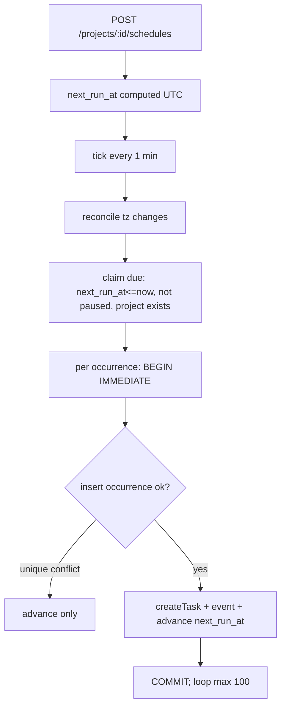

<!-- Plan written by plan mode from the hand-off and planning standards (H2H-01). Compare with BASE-01-plan.md. -->

---
feature: recurring-tasks
prd_updated: 2026-10-08
size: large
gating: hard
mode: existing
gates: {1: pending, 2: pending, 3: pending}
---
# Plan: Recurring tasks

**Context.** Teams re-create routine tasks by hand and forget them. We add schedules (daily / weekly / every 2 weeks / monthly) that create each occurrence as its own task, never losing or doubling one. Design is agreed in `.craft/handoff/recurring-tasks.md`; this plan turns it into gated build steps. Plan only: no code until approved.

## Step 0 — Save (first step after approval)
1. Write this plan verbatim to `.craft/features/recurring-tasks/plan.md` (frontmatter above).
2. Write the Guardrails section to `CLAUDE.local.md` (git-excluded via `.git/info/exclude`; never `CLAUDE.md`).
3. Write held files: `.craft/project.md` (stack Node 22, Express 4, node:sqlite, node-cron 3, node:test; conventions: services take `db` first, return `null` for non-members, throw for validation; infrastructure: node-cron only, no queue/events/flags/migrations) and `.craft/state.md` (last completed step).
4. Apply the PRD amendment (X-1, X-2) to `prd.md` Later-changes table.
5. Delete `.craft/handoff/recurring-tasks.md`. Begin Gate 1.

## 1. Inputs accounted for
| Input | Says | Lands in |
|---|---|---|
| Hand-off | Design, D-1..D-8, numbers, gate suggestion, held files | D-table, Gates, Step 0 |
| PRD R-1..R-7, AC-1.1..7.1 | What must be true | Test matrix, gates |
| PRD R-1 / AC-1.2 "labels" | Repeat labels | **Departure**: deferred (D-2, X-1); PRD amended |
| PRD AC-6.3 "deleted or archived" | No tasks for gone project | **Departure**: delete only; archive half waits (D-4, X-2) |
| PRD §10 "creator no longer a member" | No tasks if creator left | Kept, handoff silent → X-3 |
| PRD §10 "visibility follows original" | Same visibility | No visibility concept in `tasks` → X-4 |
| Code: `createTask`, `isMember`, `projects.timezone`, digest job, smoke tests | Reuse | Reuse list, Files touched |
| Brief | none | No `I-n` / `U-n` beyond PRD U-1..3 |
| Open question (late notification) | Still with Product | Readiness R-1 |

## 2. Scope
**Must:** schedules/occurrences/events tables; tz function (`recurrence.js`); 1-min tick with claim, catch-up (cap 100), idempotency; create (AC-1.1), list (paged 25), 50 limit; membership 404s; timezone/DST/31st; events; kill-switch flag.
**Should:** pause/resume, edit time, delete, skip (P1: R-3, R-5).
**Not built:** labels, archive flag/handling, custom rules, repeat-after-completion, subtasks/attachments, new notifications, UI, new dependencies, migration framework.

## 3. Decisions
| ID | Decision | Choice | Alternatives | Reason | Status |
|---|---|---|---|---|---|
| D-1..D-8 | As hand-off table (tick, labels deferred, events table, delete-only, Intl, cap 100, skip row, limits) | per hand-off | per hand-off | per hand-off | agreed |
| D-9 | Template | Snapshot title/description/assignee on the schedule (optional `task_id` copies from an existing task in the same project at creation) | Link to original task | Original may be edited/deleted; schedule must be self-contained | assumption |
| D-10 | Late | `late=1` when created > 5 min after scheduled instant; emit `occurrence_created` always, plus `occurrence_late` when late | Only late event | Metric "within 5 min" = created minus late | assumption |
| D-11 | DST gap / overlap | Gap: use pre-change offset (02:30→03:30 local). Overlap: earlier instant | Skip / run twice | Never lost, never doubled; verify on Node 22 in Gate 1 | assumption |
| D-12 | Timezone change (AC-4.2) | Each schedule stores `tz_at_compute`; tick first recomputes `next_run_at` from `next_occurrence_date` for schedules whose project tz differs | Hook in project update | No tz-edit endpoint exists; DB-level check covers any writer | assumption |
| D-13 | Delete | Hard-delete schedule + its occurrences; tasks stay; events retained (no FK) | Soft delete | AC-3.2; no flag per D-4 spirit | assumption |
| D-14 | Flag | env `RECURRENCE_TICK=off` disables tick; default on | Default off | Rollback without deploy; tests call job directly | assumption |
| D-15 | Biweekly | `anchor_date` (creation week's chosen date); every 14 days from it | Week parity | Stable across year boundary | assumption |
| X-1 | PRD says labels repeat; `tasks` has no labels | Amend PRD R-1/AC-1.2/§7 (D-2) | — | Resolved | agreed |
| X-2 | AC-6.3 archive vs no archive feature | Delete-only now | — | Resolved | agreed |
| X-3 | Hand-off silent on creator leaving; `createTask` returns `null` for non-members | Tick treats `null` as fail-closed: pause schedule, emit `schedule_paused_creator_left`, create nothing | Run as system | Matches PRD §10 | needs Developer confirm (R-2) |
| X-4 | "Same visibility" but tasks have none | Created tasks are ordinary project tasks | — | Nothing to inherit | assumption |

## 4. How it works

Steps: (1) member creates schedule → validated, tz read from `projects.timezone`, `next_run_at` stored. (2) Tick runs `runRecurrence(db, now)`. (3) Reconcile tz. (4) Claim due rows. (5) Per occurrence one transaction: re-read row, compare `next_run_at` unchanged (CAS), `INSERT occurrences`, `createTask(db, project_id, created_by, {title, description, assignee_id, due_date: occurrence_date})`, set `task_id`, write event, advance schedule. (6) Stop at 100; the rest continue next tick.

**Files — existing (changed):** `src/db.js` (3 tables + indexes via `CREATE TABLE IF NOT EXISTS`), `src/app.js` (mount routes), `src/server.js` (schedule tick, flag), `test/smoke.test.js` (untouched; new tests go in new files), `.craft/features/recurring-tasks/prd.md` (amendment).
**Files — new (additions):** `src/modules/schedules/recurrence.js` (pure time maths), `schedule.service.js`, `schedule.routes.js`, `src/jobs/recurrence.js` (`runRecurrence`, `scheduleRecurrence`), `test/recurrence.test.js`, `test/schedules.test.js`, `test/recurrence-job.test.js`.

**Data model**
- `schedules(id, project_id, created_by, title, description, assignee_id, frequency CHECK IN ('daily','weekly','biweekly','monthly'), weekday 0-6, day_of_month 1-31, local_time 'HH:MM', anchor_date, next_occurrence_date, next_run_at, tz_at_compute, paused INT DEFAULT 0, created_at)`; index `(paused, next_run_at)`.
- `occurrences(id, schedule_id, occurrence_date, status CHECK IN ('created','skipped'), late INT DEFAULT 0, task_id, created_at, UNIQUE(schedule_id, occurrence_date))`.
- `events(id, name, project_id, schedule_id, frequency, created_at)`.
Migration: additive `IF NOT EXISTS` in `createDb` (the project's only mechanism); no backfill; rollback = flag off, tables unused.

**API** (all `requireAuth`; JSON)
- `POST /projects/:id/schedules` `{title?, description?, assignee_id?, task_id?, frequency, time:"HH:MM", weekday?, day_of_month?}` → 201 `{id, project_id, frequency, time, next_occurrence_date, next_run_at, paused:false}`.
- `GET /projects/:id/schedules?page=1` → `{items:[…], page, page_size:25, total}` newest first.
- `PATCH /schedules/:id` `{time?, weekday?, day_of_month?, paused?}` → 200 schedule (applies from next occurrence).
- `DELETE /schedules/:id` → 204.
- `POST /schedules/:id/skip` `{date:"YYYY-MM-DD"}` → 200 `{occurrence_date, status:"skipped"}`.

**Errors**
| Code | HTTP | Message |
|---|---|---|
| PROJECT_NOT_FOUND (also non-member) | 404 | Project not found |
| SCHEDULE_NOT_FOUND (also non-member) | 404 | Schedule not found |
| VALIDATION | 400 | e.g. "Choose daily, weekly, every two weeks or monthly"; "Time must look like 09:00"; "Title is required" |
| SCHEDULE_LIMIT | 409 | This project already has 50 repeating tasks. Delete one to add another. |
| OCCURRENCE_EXISTS | 409 | That task was already created. `{task_id}` returned so the client can open it. |
| NOT_AN_OCCURRENCE | 400 | That date is not one of this schedule's upcoming dates |

## 5. Invariants
| ID | rule | enforced in code by | enforced in the database by | test |
|---|---|---|---|---|
| INV-1 | One task per occurrence | tick catches conflict → advance only | `UNIQUE(schedule_id, occurrence_date)` | T-04, T-05 |
| INV-2 | No missed occurrence lost or doubled | loop until `next_run_at > now` (cap 100) | same unique key; task+advance in one txn | T-06, T-07 |
| INV-3 | Only members manage schedules; others get 404 | `isMember` in service | — | T-22, T-23 |
| INV-4 | ≤50 schedules per project | count inside creating txn | — (SQLite has no cap constraint) | T-24 |
| INV-5 | Frequency / pause values valid | validation | `CHECK` constraints | T-21 |
| INV-6 | No task if project gone or creator not a member | claim joins `projects`; `createTask` null → pause | — | T-25, T-26 |
| INV-7 | Skipped date never yields a task | unique conflict on skipped row | unique key | T-18 |

## 6. State and consistency
Schedule: `active → paused` (PATCH; none else), `paused → active` (PATCH; `next_run_at` recomputed from now, no back-fill of paused period), `active|paused → deleted` (DELETE; occurrences removed in same txn). Forbidden: any change by a non-member; resume making past occurrences.
Occurrence: `(none) → created` (tick; task + event + advance, one txn), `(none) → skipped` (skip route; event, one txn). Forbidden: `created → skipped` (409), `skipped → created`.
Transactions: required for tick (per occurrence, `BEGIN IMMEDIATE`), schedule creation (limit race), skip, delete. No external calls exist (notifications untouched).
Races: CAS on `next_run_at` + unique key prevent double tick / two instances; count-inside-txn prevents two simultaneous creates exceeding 50.

## 7. Failure modes
| What fails | What happens | Recovery |
|---|---|---|
| Crash mid-occurrence | txn rolls back: no task, no advance | Next tick redoes it |
| Double tick / two instances | Unique conflict or CAS mismatch → no-op | None needed |
| Outage | Loop creates each missed one, marked late | Cap 100/run; rest on next ticks |
| Tick overruns 1 min | `running` guard skips overlapping run | Next tick |
| `createTask` throws (e.g. empty title) | Txn rolls back; schedule paused after 3 consecutive failures? **No**: log `occurrence_failed`, leave unchanged, retry next tick | Fail closed; no silent skip |
| `createTask` returns null (creator left) | Pause schedule, event | Member resumes after fixing |
| Intl rejects timezone | Schedule not processed, logged | Fail closed |
| Project row deleted | Excluded by claim join | None |

## 8. Security
| ID | Threat | Mitigation | Test |
|---|---|---|---|
| T-1 | Non-member reads/changes schedules (IDOR by schedule id) | Resolve schedule → project → `isMember`; 404 for both | T-22, T-23 |
| T-2 | Template copied from another project's task | `task_id` must belong to same project | T-27 |
| T-3 | Schedule flood / task flood | 50 limit in txn; cap 100 per run | T-24, T-07 |
| T-4 | Creator removed but schedule keeps creating | X-3 pause | T-26 |
| T-5 | Bad input (time, dates, tz, huge text) | Validate; title ≤200, description ≤5000; prepared statements only | T-21 |
| T-6 | Assignee not a member | Allowed as today's `createTask` (existing behavior); noted, not widened | — |
Secrets: none new. Never log titles/descriptions; log ids only.

## 9. Numbers
Tick 1 min · target 99% within 5 min · limit 50/project · page 25 · cap 100/schedule/run · late threshold 5 min · expected events a few thousand/day · skip horizon 366 days · title ≤200, description ≤5000.

## 10. Observability
Events (table): `schedule_created`, `schedule_paused_creator_left`, `occurrence_created`, `occurrence_late`, `occurrence_skipped`. Log lines: `recurrence.tick.start/done {claimed, created, durationMs}`, `recurrence.occurrence.failed {scheduleId, occurrenceDate, reason}`, `recurrence.tz.recomputed`, `recurrence.cap.hit {scheduleId}`. Correlate by `scheduleId` + `occurrence_date` (+ `task_id`).

## 11. Test plan
| ID | Pri | Type | Scenario → expected | ACs covered |
|---|---|---|---|---|
| T-01 | High | unit | Weekly Mon 09:00 Berlin → correct UTC next_run | AC-1.1 |
| T-02 | High | integration | POST schedule → 201 with `next_occurrence_date` | AC-1.1 |
| T-03 | Critical | integration | Due schedule → task with title/desc/assignee, status open, due = occurrence date | AC-1.2 |
| T-04 | Critical | integration | Run tick twice same instant → one task | AC-1.3 |
| T-05 | Critical | integration | Two concurrent `runRecurrence` on same file DB → one task | AC-1.3 |
| T-06 | Critical | integration | 3 missed weekly → 3 tasks, each late | AC-2.1, AC-2.2 |
| T-07 | High | integration | 150 missed daily → 100 first run, rest next run, none duplicated | AC-2.2 |
| T-08 | High | unit | Monthly 31st in 30-day month and Feb (leap/non-leap) → last day | AC-1.4 |
| T-09 | High | integration | Pause → no tasks; resume → continues, old tasks intact | AC-3.1 |
| T-10 | High | integration | Delete → tasks remain, no more created | AC-3.2 |
| T-11 | High | integration | Edit time → applies next occurrence; past tasks unchanged | AC-3.3 |
| T-12 | Critical | unit | DST spring gap & autumn overlap Berlin, New_York keep 09:00 local; gap/overlap times per D-11 | AC-4.1 |
| T-13 | Critical | integration | Change project tz → recompute; no duplicate/skip across switch | AC-4.2 |
| T-14 | High | integration | Skip upcoming date → no task, later ones fine | AC-5.1 |
| T-15 | High | integration | Skip already-created → 409 with `task_id` | AC-5.2 |
| T-16 | High | integration | Skip then tick over date → still no task | AC-5.1 |
| T-17 | Medium | integration | Skip non-occurrence date → 400 | AC-5.1 |
| T-18 | Critical | integration | Skipped row blocks creation even if tick races | AC-5.1 |
| T-21 | Medium | integration | Invalid frequency/time/day/title → 400 | AC-1.1 |
| T-22 | Critical | integration | Non-member POST/GET list → 404, nothing written | AC-6.1 |
| T-23 | Critical | integration | Non-member PATCH/DELETE/skip by schedule id → 404, unchanged | AC-6.1 |
| T-24 | High | integration | 51st schedule → 409; parallel creates at 49 → max 50 | AC-6.2 |
| T-25 | High | integration | Project deleted → tick creates nothing | AC-6.3 |
| T-26 | Critical | integration | Creator removed from `members` → no task, schedule paused | AC-6.3 (§10) |
| T-27 | High | integration | `task_id` from other project → 400 | AC-6.1 |
| T-28 | Medium | integration | 60 schedules (at 50 limit boundary seeded): list page 1 = 25 newest first, page 2 next | AC-6.4 |
| T-29 | High | integration | Create / create-occurrence / skip each write event with project_id + frequency, same txn | AC-7.1 |
| T-30 | Medium | integration | `RECURRENCE_TICK=off` → no job registered | — |
| E2E-1 | High | e2e | See release flows | AC-1.1, 1.2, 7.1 |
(T-19, T-20 intentionally unused; IDs stable with matrix drafts.) Every AC 1.1–7.1 appears above.

## 12. Gates

### Gate 1 — Data layer and time maths
**Goal:** tables exist and one tested function computes occurrences.
**Delivers:** the three tables in `createDb`; `recurrence.js` with `nextOccurrence(rule, tz, from)` and `localToUtc`; verified Node 22 DST behaviour (D-5/D-11).
**Files:** `src/db.js`; new `src/modules/schedules/recurrence.js`, `test/recurrence.test.js`.
**Steps:** - [ ] 1.1 write T-01, T-08, T-12 first - [ ] 1.2 add tables, constraints, indexes - [ ] 1.3 implement `localToUtc` (Intl offset search) - [ ] 1.4 implement `nextOccurrence` for 4 frequencies - [ ] 1.5 record state.
**Tests:** T-01, T-08, T-12.
**Exit checklist:** `npm test` green incl. T-01, T-08, T-12; existing 5 smoke tests green; gap/overlap results recorded in plan if differing from D-11.
**Unblocks:** Gate 2.

### Gate 2 — Tick job, claiming, catch-up, idempotency
**Goal:** due schedules turn into exactly one task each, safely.
**Delivers:** `runRecurrence(db, now)`; tz reconcile; per-occurrence txn; catch-up with cap; late flag; events for created/late; flag-guarded `scheduleRecurrence` wired in `server.js`.
**Files:** new `src/jobs/recurrence.js`, `test/recurrence-job.test.js`; changed `src/server.js`. Reuses `createTask`, `scheduleDigest` pattern.
**Steps:** - [ ] 2.1 write T-03..T-07, T-13, T-18, T-25, T-26 - [ ] 2.2 claim + CAS + unique insert - [ ] 2.3 createTask in txn, advance - [ ] 2.4 catch-up loop/cap/late - [ ] 2.5 tz reconcile - [ ] 2.6 creator-left pause, overlap guard - [ ] 2.7 cron + flag (T-30) - [ ] 2.8 record state.
**Tests:** T-03, T-04, T-05, T-06, T-07, T-13, T-18, T-25, T-26, T-30.
**Exit checklist:** those tests pass; killing the process mid-run in a test leaves no half-state (rollback test); `RECURRENCE_TICK=off node src/server.js` registers no job.
**Unblocks:** Gate 3.

### Gate 3 — Routes, permissions, limits, skip, pause, events, PRD amendment
**Goal:** members manage schedules over the API.
**Delivers:** the five endpoints; membership 404s; 50 limit; paging; pause/resume/edit/delete/skip; `schedule_created` and `occurrence_skipped` events; PRD amended (labels, archive).
**Files:** new `schedule.service.js`, `schedule.routes.js`, `test/schedules.test.js`; changed `src/app.js`, `prd.md`.
**Steps:** - [ ] 3.1 write T-02, T-09..T-11, T-14..T-17, T-21..T-24, T-27..T-29 - [ ] 3.2 service (db first, `null` for non-members, throw for validation) - [ ] 3.3 routes - [ ] 3.4 skip logic - [ ] 3.5 events - [ ] 3.6 PRD amendment - [ ] 3.7 run release flows.
**Tests:** T-02, T-09, T-10, T-11, T-14, T-15, T-16, T-17, T-21, T-22, T-23, T-24, T-27, T-28, T-29, E2E-1.
**Exit checklist:** full `npm test` green; every AC 1.1–7.1 traced to a passing test; release flows pass; PRD diff shows labels/archive amendments.
**Unblocks:** release.

Implementation sequence: Step 0 → 1.x → **GATE 1** → 2.x → **GATE 2** → 3.x → **GATE 3**. Each gate is a hard stop until the Developer says continue.

## 13. Guardrails (to `CLAUDE.local.md`)
- NEVER create a task outside the per-occurrence transaction · ALWAYS insert the occurrence row first and treat a unique conflict as success.
- NEVER compute local time ad hoc · ALWAYS use `recurrence.js`.
- NEVER log titles/descriptions · ALWAYS log ids.
- NEVER reveal that a project/schedule exists to non-members · ALWAYS 404.
- NEVER add dependencies, labels, or archive handling · ALWAYS use Node built-ins.
- NEVER guess on ambiguity (creator left, bad tz) · ALWAYS pause/skip and emit an event (fail closed).
- Tests: write Critical tests first; ALWAYS use in-memory DB, inject `now`.

## 14. Release flows
1. **Weekly report:** alice logs in → creates weekly Monday 09:00 schedule on Website → tick at due time → one task appears, status open → second tick → still one → events recorded.
2. **Outage recovery:** 3 occurrences missed → tick creates 3 late tasks, none doubled; failure path: creator removed → schedule paused, no tasks.
3. **Holiday skip:** skip next date → tick passes it → none created; skipping an existing one → 409 with link.

## 15. Scope tiers
Never reduced: INV-1..7, DST/tz correctness, Critical tests, membership 404s. Should tier (off critical path, cut in this order): 1) skip route polish (T-17), 2) edit-time (AC-3.3), 3) delete/pause extras beyond core, 4) list paging nicety. Core P0 path: Gates 1–2 + create route.

## 16. Risks
| Risk | Impact | Mitigation |
|---|---|---|
| Node 22 Intl DST edge behaviour differs | Wrong run time | Gate 1 fixture tests; D-11 revisit |
| Tick and HTTP writers share one SQLite connection | Interleaved txns | Synchronous API; keep txns short |
| `createTask` ignores status/labels | AC-1.2 partial | Status default open; labels amended |
| Product answer on late notification | Rework | Default none (R-1) |

## 17. Definition of done
- [ ] All gates `passed`; `npm test` green · [ ] every AC in the matrix · [ ] every INV and T-n mitigation tested · [ ] release flows run · [ ] PRD amended · [ ] flag off verified · [ ] handoff deleted, state.md current.

## 18. Readiness
**Blocking (Developer decides before Gate 2):** R-2 — confirm X-3 (pause schedule when creator left; alternative: keep creating as system user).
**Non-blocking (documented):** R-1 late-notification question with Product; default is no differing notification (none exists in code). D-9..D-15 assumptions.

## Verification
`npm test` after each gate; manual: `PORT=3000 npm start`, login as alice, POST a schedule, shorten tick via injected `now` in test; run with `RECURRENCE_TICK=off` to confirm disabled.
