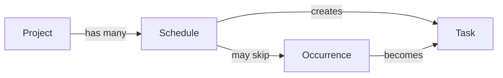
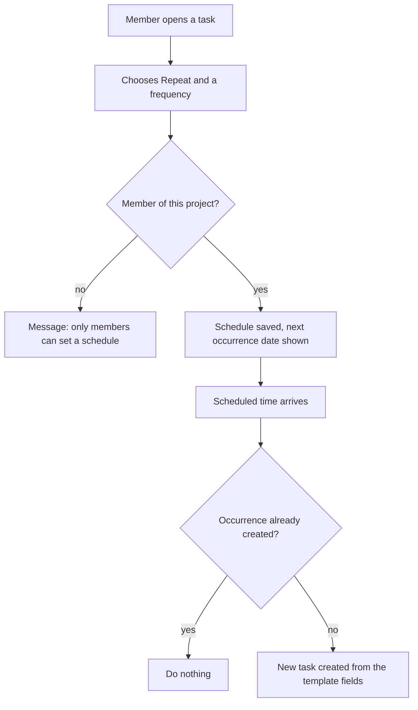

<!-- Golden example. A fictional task app, used as the quality bar for PRDs: problem not solution, testable ACs, honest about what is unknown. Every name and number is made up for illustration. -->

# Recurring tasks

> Let a team member set a task to repeat on a schedule, so routine work like the weekly report appears on its own instead of being re-created by hand.

| | |
|---|---|
| **Author** | Developer |
| **Updated** | 2026-10-08 |
| **Related** | Brief (`brief.md`) · Plan (`plan.md`) · support requests (see Appendix) |

---

## 1. The problem

Teams re-create the same tasks every week or month by hand. They copy last week's task, change the date and reassign it. People forget, copy the wrong version, or stop doing the routine work at all.

- Three teams asked for this on the feedback board (linked in the Appendix). There is no usage data yet, so the size of the problem is not measured.
- Today a missed routine task is invisible: nothing exists to be overdue.

## 2. Target users and use cases

### Target users

| Who | What they're trying to do | Notes |
|---|---|---|
| Team lead | Make sure routine work is always on the board | Creates the task once, expects it to keep appearing |
| Project member | Do routine work without being reminded | Sees the new task in their list |
| Office manager | Run month-end checks | Needs a date-based rule ("the 1st"), not "every 30 days" |

### Use cases

- **U-1** As a team lead, I want my weekly report task to appear every Monday at 09:00, so that nobody has to remember to create it. *(primary)*
- **U-2** As an office manager, I want a "check invoices" task on the 1st of every month, even in months with fewer days, so that month-end work is never skipped.
- **U-3** As a project member, I want to skip one occurrence when the team is on holiday, so that an unwanted task does not appear.

## 3. Current journey

1. The team lead opens last week's report task. → 2. Copies it. → 3. Edits the date and the assignee. → 4. Saves. *(This is where it gets forgotten: it depends on someone remembering.)*

## 4. Landscape

Not needed for this Feature.

## 5. Proposed solution

A task can repeat daily, weekly, every two weeks or monthly. The app creates each new occurrence automatically at the scheduled time, as its own task with its own status.

**Top value for members**
1. Routine work appears on time without anyone remembering.
2. Each occurrence is its own task, so one late week does not hide the next.
3. Missed occurrences are never lost and never doubled.

**Conceptual model**

## 6. Goals

- Routine tasks appear on schedule without manual work.
- A team can trust that no occurrence is missed or duplicated.

## 7. Out of scope

- Nothing is out of scope. We will build everything.

## 8. Measurable outcomes

| Outcome | Metric | Baseline | Target | How it is measured |
|---|---|---|---|---|
| Teams adopt recurring tasks | Projects with at least one schedule, 30 days after launch | unknown, measure first | to set after two weeks of data | event `schedule_created` |
| Occurrences are created reliably | Occurrences created within 5 minutes of their time | not applicable | 99% | events `occurrence_created` and `occurrence_late` |

## 9. Requirements

**Priorities:** **P0** = needed for members to adopt (MVP) · **P1** = makes it good, not just usable · **P2** = nice to have

### U-1 · Weekly report

A team lead sets a task to repeat once, and each Monday the new task is just there.

#### R-1 [P0] A member can make a task repeat daily, weekly, every two weeks or monthly

*Why:* removes the manual copy that causes forgotten routine work.

- **AC-1.1** Given a task in a project the member belongs to, when they choose "Repeat weekly on Monday at 09:00", then a schedule is saved and the date of the next occurrence is shown.
- **AC-1.2** Given a schedule whose time has arrived, when the app processes it, then one new task is created with the title, description, assignee and labels of the original, status Open, and a due date of that occurrence.
- **AC-1.3** Given the same occurrence is triggered twice (for example after a restart), when both are processed, then exactly one task exists for that occurrence.
- **AC-1.4** Given a monthly schedule on the 31st, when a month has 30 days, then the task is created on the last day of that month.

#### R-2 [P0] Missed occurrences are created once when the app recovers

*Why:* routine work must not vanish because of an outage.

- **AC-2.1** Given the app was unavailable at the scheduled time, when it recovers, then each missed occurrence is created once and marked "created late".
- **AC-2.2** Given several occurrences were missed, when the app recovers, then one task is created per missed occurrence and none is skipped.

#### R-3 [P0] A member can see and manage a schedule

*Why:* people need to change course without deleting history.

- **AC-3.1** Given a schedule, when a member pauses it, then no new tasks are created until it is resumed, and existing tasks are untouched.
- **AC-3.2** Given a schedule, when a member deletes it, then existing tasks stay and no further tasks are created.
- **AC-3.3** Given a schedule, when a member edits its time, then the change applies from the next occurrence and past tasks are unchanged.

### U-2 · Month-end checks

#### R-4 [P0] A schedule runs in the project's timezone

*Why:* "09:00" must mean the same local hour all year.

- **AC-4.1** Given a project in the Europe/Berlin timezone and a schedule at 09:00, when the clocks change, then the next task is still created at 09:00 local time.
- **AC-4.2** Given a project whose timezone is changed, when the next occurrence is calculated, then it uses the new timezone and no occurrence is created twice or skipped at the switch.

### U-3 · Holiday week

#### R-5 [P0] A member can skip one occurrence

*Why:* a real team's calendar is not a pure rule.

- **AC-5.1** Given a schedule with an upcoming occurrence, when a member skips it, then no task is created for that date and later occurrences are unaffected.
- **AC-5.2** Given an occurrence that has already been created, when a member tries to skip it, then they are told that task already exists and offered to open it.

### Lifecycle and edge cases

#### R-6 [P0] Schedules respect permissions and limits

- **AC-6.1** Given a person who is not a member of the project, when they try to create or edit a schedule, then it is refused and nothing changes.
- **AC-6.2** Given a project with 50 schedules, when a member adds another, then it is refused with a message that explains the limit.
- **AC-6.3** Given a project that is deleted or archived, when occurrences come due, then none are created.
- **AC-6.4** Given a project with many schedules, when a member opens the list, then it is shown 25 at a time, newest first.

### Measurement

#### R-7 [P0] The product team can see adoption and reliability

- **AC-7.1** Given a schedule is created, an occurrence is created or an occurrence is skipped, when it completes, then an event with the project id and the frequency is recorded.

## 10. Access, privacy and security rules

| Rule | Covered by |
|---|---|
| Only members of a project can create, edit, pause, skip or delete its schedules | AC-6.1 |
| A schedule never creates tasks in a project the schedule's creator no longer belongs to | AC-6.3 |
| Created tasks follow the same visibility as the original task | AC-1.2 |

## 11. Constraints

None known.

## 12. Phases

A single phase: all P0 and P1 requirements.

## 13. Ideas for later

- Suggest making a task recurring after it has been copied by hand three times. *Why interesting:* turns an existing habit into a schedule. *Worth doing when:* adoption data shows people still copy tasks.
- Rotate the assignee among members each occurrence.

## 14. Assumptions

- Four frequencies are enough for the first version.
- "Created late" tasks keep their original due date, so they show as overdue.

## 15. Open questions

| Question | Why it matters | Owner | Needed by |
|---|---|---|---|
| What is the baseline number of hand-copied routine tasks? | Sets the adoption target | Product | before launch |
| Should a late occurrence notify the assignee differently? | Affects the notification rules | Product | before plan |

## 16. Appendix

### Alternatives considered
- **Repeat after completion** ("two weeks after done"): rejected because the schedule drifts and a late week moves every later week.

### Decisions
- Each occurrence is its own task, not a reopened one, so history and status are never overwritten.

---

## Later changes

| Date | Change | IDs | Reason |
|---|---|---|---|
