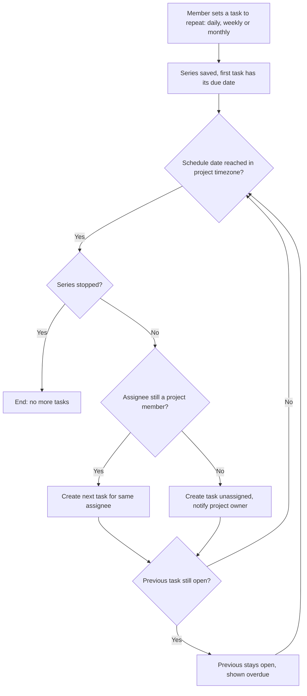

# Recurring tasks

> Project members mark a task as repeating daily, weekly or monthly. The next task appears on schedule, so teams stop retyping routine work and stop missing it when nobody remembers.

| | |
|---|---|
| **Author** | Developer |
| **Updated** | 2026-10-09 |
| **Related** | Plan (`plan.md`) |

---

## 1. The problem

Teams that do the same work every week re-create the same tasks by hand. When nobody does, the work is missed.

- Evidence: three teams asked for this on the feedback board (source: Developer, feedback board; no links or counts given).
- Evidence: two teams missed their weekly report last month because nobody created the task (source: Developer).
- No usage data exists, so we cannot say how many tasks are repeats.
- Why now: the missed reports have already cost real teams something, on top of the three requests.

## 2. Target users and use cases

### Target users

| Who | What they're trying to do | Notes |
|---|---|---|
| Project member (owner or member) | Have routine work appear automatically | Teams with weekly or monthly routines, e.g. a weekly report |
| Assignee | See each occurrence as their own task | Same person every time |
| Project owner | Know when a series can no longer reach its assignee | |

### Use cases

- **U-1** As a project member, I want a task to repeat on a schedule, so that routine work appears without anyone remembering to create it. *(primary)*
- **U-2** As a project member, I want to change or stop a repeating task, so that the series stays correct as the work changes.
- **U-3** As a project owner, I want to know when a series loses its assignee, so that work is not silently dropped.

## 3. Current journey

1. Someone remembers the routine work → 2. creates the task by hand, same title and assignee → 3. **if nobody remembers, the task never exists** → 4. the work is missed.

## 5. Proposed solution

A task can be set to repeat daily, weekly or monthly. On each schedule date, in the project's timezone, a new task is created for the same assignee. An unfinished task is never dropped: it stays open and shows as overdue.

**Top value for users:**
1. Routine work appears without anyone remembering.
2. Unfinished work is never silently replaced or lost.
3. Fewer repetitive steps for each team.

## 6. Goals

- Routine work is never missed because nobody created the task.
- Teams stop retyping the same tasks.

## 7. Out of scope

- Custom schedules (e.g. every 2nd Tuesday): later, if the three schedules prove too limited.
- Rotating assignees: the assignee stays the same.
- Editing a whole series including open tasks: edits apply to future occurrences only.
- Task templates: a separate idea.
- A "repeats" marker on tasks and the digest: see Ideas for later.

## 8. Measurable outcomes

| Outcome | Metric | Baseline | Target | How it's measured |
|---|---|---|---|---|
| Routine work is not missed | Scheduled occurrences that were not created | Unknown, measure first (two teams missed a weekly report last month) | Zero | Created vs scheduled occurrences (R-8) |
| Teams use the feature | Active series | Unknown, measure first (no usage data) | Not set | Count of series (R-8) |

## 9. Requirements

**Priorities:** **P0** = needed for target users to adopt (MVP) · **P1** = makes it good, not just usable · **P2** = nice to have

### U-1 · Set a task to repeat

A member makes a task repeat once, and from then on the work appears on its own.

#### R-1 [P0] A project member can make a task repeat daily, weekly or monthly

*Why:* removes the hand re-creation that causes missed work.

- **AC-1.1** Given a project member and an existing task with a due date, when they set it to repeat weekly, then the task starts a series and the next occurrence is scheduled one week after its due date.
- **AC-1.2** Given a task that repeats, when the schedule date arrives in the project's timezone, then a new open task with the same title, description, project and assignee is created.
- **AC-1.3** Given a person who is not a member of the project, when they try to make a task repeat, then it is refused and no series is created.
- **AC-1.4** Given a task with no recurrence (every task that exists today), when the schedule runs, then it is unchanged and no task is created from it.

#### R-2 [P0] The next task is created on schedule even if the previous one is still open

*Why:* a neglected task must not silently stop the series; that is the failure we are fixing.

- **AC-2.1** Given a series whose latest task is still open, when the next schedule date arrives, then the next task is created and the older one stays open.
- **AC-2.2** Given an older occurrence that is open and past its due date, when it is viewed or appears in the daily digest, then it shows as overdue, like any overdue task.
- **AC-2.3** Given a series whose latest task is completed, when the next schedule date arrives, then the next task is created, and completing a task does not create the next one earlier.

#### R-3 [P0] Monthly tasks always appear, even in short months

*Why:* skipping a month would drop a report, the failure we are fixing.

- **AC-3.1** Given a monthly series set for the 31st, when the month has fewer than 31 days, then the task is created on that month's last day.
- **AC-3.2** Given a monthly series set for the 31st, when the month has 31 days, then the task is created on the 31st.

#### R-4 [P1] Dates follow the project's timezone

*Why:* projects have a timezone today and teams read dates in it.

- **AC-4.1** Given a project in Europe/Berlin and a daily series, when a new calendar day starts in Europe/Berlin, then the occurrence is created with that local date as its due date.
- **AC-4.2** Given the project's timezone is changed, when the next occurrence is created, then it uses the new timezone and past tasks are unchanged.

### U-2 · Change or stop a repeating task

#### R-5 [P0] A project member can stop a series

*Why:* routines end, and a stopped series must really stop.

- **AC-5.1** Given a series, when a member chooses "stop repeating", then no further tasks are created.
- **AC-5.2** Given a series is stopped, when it is stopped, then all tasks already created (open or completed) are unchanged.

#### R-6 [P1] A project member can edit a series for future occurrences

*Why:* the work changes (title, assignee, schedule); open tasks should not change under someone mid-work.

- **AC-6.1** Given a series, when a member changes its title, assignee or schedule, then only occurrences created after the change use the new values.
- **AC-6.2** Given open or completed tasks from the series, when the series is edited, then those tasks are unchanged.

### U-3 · Handle a missing assignee

#### R-7 [P0] A series whose assignee left the project keeps producing tasks and tells the owner

*Why:* work must not be dropped, and tasks must not be assigned to non-members.

- **AC-7.1** Given a series whose assignee was removed from the project, when the next occurrence is due, then it is created unassigned.
- **AC-7.2** Given an unassigned occurrence was created for that reason, when it is created, then the project owner is told which series lost its assignee.
- **AC-7.3** Given the series is edited to a current member, when the next occurrence is due, then it is created for that member.

### Lifecycle and edge cases

#### R-9 [P1] A deleted project stops producing tasks

*Why:* a deleted project must not keep creating tasks.

- **AC-9.1** Given a project that is deleted, when the next schedule date arrives, then no task is created.
- **AC-9.2** Given the task that started a series is deleted, when the next schedule date arrives, then the series still creates its next task until it is stopped. *(Assumption 1.)*

#### R-10 [P1] The schedule does not create duplicates

*Why:* a restart or repeat run must not give a team two copies of the same task.

- **AC-10.1** Given an occurrence already created for a schedule date, when the schedule runs again for that date, then no second task is created.
- **AC-10.2** Given the app was down on one or more schedule dates, when it starts again, then one occurrence is created for the missed period, not one per missed run. *(Assumption 2.)*

### Measurement

#### R-8 [P0] The product team can see how many series exist and whether occurrences were created

- **AC-8.1** Given a series, when an occurrence is created or fails to be created on its date, then that is recorded with the series, the schedule date and the result.
- **AC-8.2** Given those records exist, when the team asks, then they can see the number of active series and of created and missed occurrences.

## 10. Access, privacy and security rules

| Rule | Covered by |
|---|---|
| Only project members can create, edit or stop a series in that project | AC-1.3 |
| Occurrences are only assigned to current project members | AC-7.1 |
| Existing tasks and the digest behave as before | AC-1.4, AC-2.2 |

## 11. Constraints

None with evidence. Generated tasks appear in the existing daily digest like any other task; the digest does not change.

## 13. Ideas for later

- A "repeats" marker on tasks and in the digest, so assignees can tell a series task from a one-off; worth doing if users ask how a task appeared.
- Custom schedules (e.g. every 2nd Tuesday); worth doing if the three schedules prove too limited.
- Rotating assignees; worth doing if teams share routine work.

## 14. Assumptions

1. Deleting the task that started a series does not stop the series (AC-9.2). Stopping is explicit.
2. After downtime, one occurrence is created for the missed period (AC-10.2).
3. Each new task copies title, description, project and assignee, and starts open.
4. A series needs a due date on its first task to schedule from.
5. Who counts as "the project owner" for notices follows the existing `owner` role.

## 15. Open questions

| Question | Why it matters | Owner | Needed by |
|---|---|---|---|
| How many existing tasks are repeats? Unknown, no usage data. | Sets the baseline and a target | Developer | before launch |
| How is the owner told (AC-7.2)? Through the existing digest, or another way. | Decides whether it fits the digest | Developer | before plan |

## 16. Appendix

### Alternatives considered

- Create the next task when the previous one is completed, rejected because a neglected task would silently stop the series.
- Custom schedules, rejected for v1 as too large.

### Decisions

- Calendar-driven creation, because the failure we are fixing is silent misses.
- Edits apply to future occurrences only, because open tasks should not change under an assignee.

---

## Later changes

| Date | Change | IDs | Reason |
|---|---|---|---|
