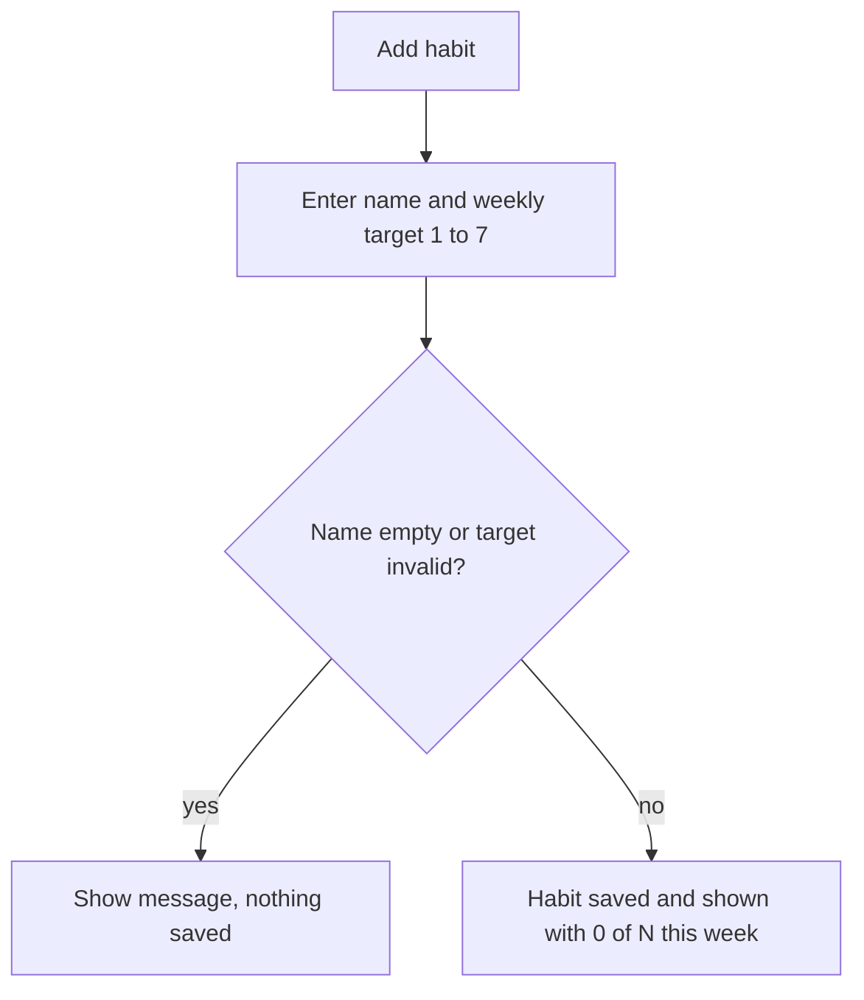
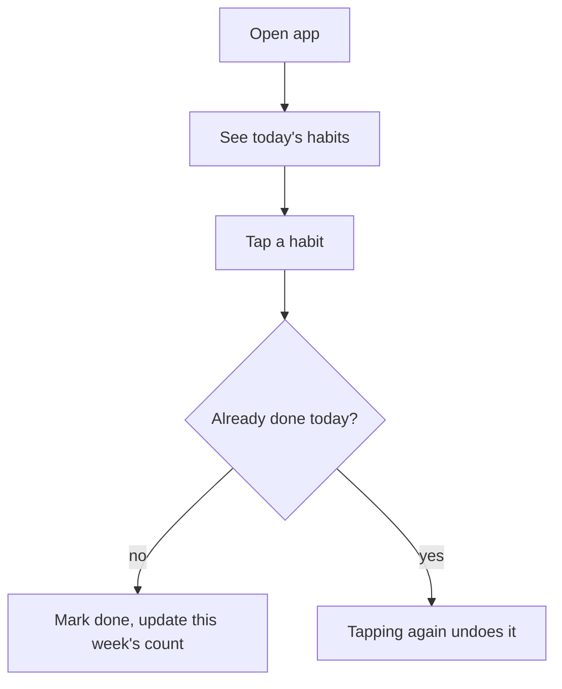

# Habit tracker

> A minimal web app where one person sets weekly habit targets, checks habits off in a few seconds, and sees whether they are on track, built to survive irregular working hours.

| | |
|---|---|
| **Author** | Developer |
| **Updated** | 2026-10-09 |
| **Related** | Plan (`plan.md`, not yet written) |

---

## 1. The problem

Existing habit trackers are too heavy and cluttered for a simple daily check. They bring accounts, many features and upsells, so the effort of using the tool competes with the habit itself. Strict daily streaks also fit badly with irregular working hours, where a "missed" day may just be a night shift.

- **Evidence:** the Developer's own experience with existing trackers (source: Developer, this conversation). No data, requests or quotes beyond that. The size of the problem for other people is not measured.
- **Why now:** the Developer starts a new job next month with irregular hours and wants a routine in place before it starts (source: Developer).

## 2. Target users and use cases

### Target users

| Who | What they're trying to do | Notes |
|---|---|---|
| The Developer (single user in v1) | Hold onto a routine despite irregular hours | Wants speed and no clutter |
| Other people (later) | Same | Not in v1, but v1 must not block adding accounts later |

### Use cases

- **U-1** As someone with irregular hours, I want to set a habit with a target of N times per week, so that a shift change does not count as failure. *(primary)*
- **U-2** As that person, I want to mark a habit done in a few seconds, including late at night, so that logging never feels like a chore. *(primary)*
- **U-3** As that person, I want to see this week's progress and past weeks per habit, so that I know whether I am on track.
- **U-4** As that person, I want to export my data, so that clearing the browser does not wipe my history.

## 3. Current journey

Not captured in detail. The Developer's summary: they open a heavy tracker, wade through features and prompts, and the effort of the tool gets in the way of the check itself. *(Open question: which tools, and which steps hurt most.)*

## 4. Landscape

Not needed for this Feature.

## 5. Proposed solution

A single-person web app. You create habits, each with a weekly target ("4 times a week"). Each day you mark a habit done. The app shows progress toward each target for the current week and a plain history of past weeks. Data stays in the browser and can be exported.

**Top value**
1. Checking a habit off is fast and nothing else gets in the way.
2. Weekly targets mean irregular hours do not break the habit.
3. Late-night check-ins land on the day you expect.

## 6. Goals

- Marking a habit done is quick enough that it does not feel like a chore.
- The weekly model reflects real progress when hours change.
- The Developer can keep their data without an account.

## 7. Out of scope

- Accounts and sync across devices. v1 is single user and data stays on one browser. Revisit when others want to use it.
- Reminders and notifications. Adds permissions and scheduling; revisit after the basic loop works.
- Social features, sharing and gamification (badges, leaderboards).
- Charts, trends and analytics beyond the plain history of past weeks.
- Backfilling past days (see Ideas for later).

## 8. Measurable outcomes

| Outcome | Metric | Baseline | Target | How it is measured |
|---|---|---|---|---|
| The tracker helps the Developer keep a routine | Share of habits that meet their weekly target in each of the first 4 weeks of the new job | unknown, measure first | "most habits", exact number to be set (see Open questions) | The app's own weekly history, read by the Developer |

## 9. Requirements

**Priorities:** **P0** = needed for the tracker to be usable (MVP) · **P1** = makes it good, not just usable · **P2** = nice to have

### U-1 · Weekly habit

#### R-1 [P0] Create a habit with a weekly target

*Why:* the weekly target is the core of the model for irregular hours.

- **AC-1.1** Given the Developer is on the habit list, when they enter a name and a target of 1 to 7 times per week and save, then the habit appears with "0 of N this week".
- **AC-1.2** Given an empty name or a target outside 1 to 7, when they try to save, then nothing is saved and a message explains what is wrong.
- **AC-1.3** Given a habit with the same name as an existing one, when they save, then they are told it already exists and nothing is saved.

#### R-2 [P1] Edit, archive and delete a habit

*Why:* routines change, and history should not be lost by accident.

- **AC-2.1** Given a habit with history, when the Developer changes its weekly target, then the new target applies from the current week and past weeks keep the target they had.
- **AC-2.2** Given a habit, when the Developer archives it, then it leaves the daily list, its history is kept and it can be restored.
- **AC-2.3** Given a habit, when the Developer deletes it, then they are asked to confirm, and on confirming the habit and its history are removed.

### U-2 · Mark done

#### R-3 [P0] Mark a habit done for today and undo it

*Why:* logging must take seconds or the tool becomes the clutter it replaces.

- **AC-3.1** Given a habit not yet done today, when the Developer taps it, then it is marked done for today and this week's count increases by one.
- **AC-3.2** Given a habit already done today, when the Developer taps it again, then the mark is removed and the count decreases by one.
- **AC-3.3** Given a habit, when it is marked done several times in one day, then it counts at most once for that day.
- **AC-3.4** Given a mark was made, when the page is reloaded, then the mark is still there.

#### R-4 [P0] The day rolls over at 4am local time

*Why:* a check-in after a late shift should count for the day just worked.

- **AC-4.1** Given a local time of 01:00, when the Developer marks a habit done, then it counts for the previous calendar day.
- **AC-4.2** Given a local time of 04:00 or later, when the Developer marks a habit done, then it counts for that calendar day.
- **AC-4.3** Given the device's time zone changes (travel), when the Developer opens the app, then "today" follows the new local time and past marks are not moved.
- **AC-4.4** Given the week boundary falls within the 00:00 to 04:00 window, when a mark is made, then it counts toward the week of the day it was assigned to, per AC-4.1.

### U-3 · Progress

#### R-5 [P0] See this week's progress per habit

*Why:* the target only helps if you can see where you stand.

- **AC-5.1** Given a habit with a target of 4 and 2 marks this week, when the Developer opens the list, then it shows "2 of 4 this week".
- **AC-5.2** Given a habit that has reached its target this week, when the Developer opens the list, then it is shown as complete, and further marks are still allowed.
- **AC-5.3** Given a new week starts, when the Developer opens the app, then all counts start from 0.
- **AC-5.4** Given no habits exist, when the Developer opens the app, then an empty state explains how to add the first habit.

#### R-6 [P1] See a plain history of past weeks per habit

*Why:* the 4-week success measure needs a record to read.

- **AC-6.1** Given a habit with past weeks, when the Developer opens its history, then each past week shows marks against that week's target and whether it was met.
- **AC-6.2** Given a habit created mid-week, when its history is shown, then the first week is shown as partial and is not counted as failed.
- **AC-6.3** Given a habit with many weeks, when the history is opened, then the newest weeks are shown first and older ones load on request.

### Data, lifecycle and edge cases

#### R-7 [P0] Data is stored on the device and survives reloads

*Why:* there are no accounts, so the browser holds the data.

- **AC-7.1** Given habits and marks exist, when the browser is closed and reopened, then everything is still there.
- **AC-7.2** Given the browser blocks or fails to save data, when the Developer makes a change, then a clear message says it was not saved.
- **AC-7.3** Given the first visit, when the app opens, then no sign-in is asked for and nothing is sent to any server.

#### R-8 [P1] Export all data

*Why:* clearing the browser or switching devices would otherwise lose everything.

- **AC-8.1** Given habits and marks exist, when the Developer chooses export, then a file is downloaded containing all habits, targets and marks.
- **AC-8.2** Given no data exists, when the Developer chooses export, then they are told there is nothing to export.

### Measurement

No event tracking: the app sends nothing anywhere (see AC-7.3). Success is read from the history (R-6).

## 10. Access, privacy and security rules

| Rule | Covered by |
|---|---|
| Data stays on the device and is never sent to a server in v1 | AC-7.3 |
| No sign-in or account in v1 | AC-7.3 |
| Deleting a habit really removes its history after confirmation | AC-2.3 |
| An export file contains only the Developer's own habit data | AC-8.1 |

## 11. Constraints

None known.

## 12. Phases

A single phase: all P0 and P1 requirements.

## 13. Ideas for later

- **Backfill past days and show "this week: 2 of 4, 3 days left".** *Why interesting:* helps when logging happens late or in batches with irregular hours. *Worth doing when:* the 4am rule is not enough in practice.
- Import from the export file, to move to another browser.
- Reminders at flexible times.
- Accounts and sync, once other people want the app.

## 14. Assumptions

1. The app is used in one browser on one device in v1.
2. Weeks start on Monday and end on Sunday.
3. A target is 1 to 7 times a week, and marks are one per habit per day.
4. The 4am day rollover is fixed, not configurable.
5. Archiving and deleting habits are included as P1 although not discussed in detail.
6. A habit created mid-week is not treated as failing that week.
7. "Done" is a simple yes/no per day, with no quantities or notes.

## 15. Open questions

| Question | Why it matters | Owner | Needed by |
|---|---|---|---|
| Which existing trackers did you try, and which steps hurt most | Sharpens the "less clutter" requirement | Developer | before plan |
| What counts as "most habits" meeting target | Gives the success measure a number | Developer | before the new job starts |
| Is 4am the right rollover for the new shifts | A wrong value would misplace marks | Developer | after first week of use |

## 16. Appendix

### Decisions
- Weekly targets, not a daily streak, because irregular hours make "missed day" misleading (Developer).
- Local-only data, plus export, instead of accounts (Developer).

---

## Later changes

| Date | Change | IDs | Reason |
|---|---|---|---|
