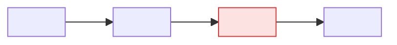
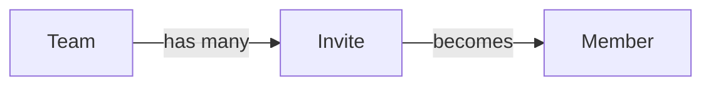
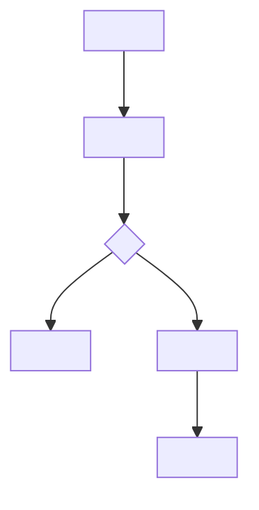

<!--
Shipcraft PRD template, format version 1.
Structure adapted from Carlin Yuen, "Writing PRDs and product requirements" (Medium), with additions for Shipcraft:
IDs, acceptance criteria, access rules, ideas for later, assumptions and change tracking.

HOW TO USE THIS TEMPLATE (for the agent; strip every HTML comment from the generated PRD)

The PRD exists so everyone agrees on WHAT to build and WHY. It is not a design or technical document.

Writing rules:
1. Problem, not missing solution. "Admins waste an hour adding 50 people one at a time" is a problem.
   "Admins can't upload a CSV" is a missing solution in disguise.
2. Functionality, not design or tech. "Admin can see who was skipped and why", not "show a red table
   under the upload button" and not "use a background job". Design and technology belong in plan.md.
3. Priorities mean something:
   P0 = without it, target users can't adopt the feature (true MVP).
   P1 = makes it good rather than merely usable.
   P2 = nice to have.
   If everything is P0, nothing is.
4. Group requirements by use case, most important first, so each use case reads as a complete
   end-to-end experience.
5. Cover the whole lifecycle, not just the happy path: first-time use, everyday use, coming back and
   changing things, many items (long lists, limits), errors and recovery, deleting or retiring,
   and leaving the product or exporting.
6. Every edge case settled in conversation becomes an acceptance criterion (AC) under the
   requirement it belongs to. There is no separate edge-case section.
7. Every requirement has at least one AC, written Given / When / Then and observable by an End user,
   an admin or an API caller. No AC may need knowledge of the implementation to verify.
8. No performance or uptime targets unless there is evidence users need them to adopt.
   Put such evidence under Constraints.
9. Include measurement: at least one requirement lets the team see whether the Measurable outcomes
   are being met.
10. At most 3 phases. Beyond that things will have changed; write a new PRD.
11. Goals: 2-3 bullets. Elevator pitch: 2-3 lines of plain English.
12. Keep it short: about 6 pages. If it's longer, split detailed areas into linked mini-PRDs.
13. Write for a reader with no background. Plain words, no jargon, no internal codenames unexplained.
14. IDs (U-n, R-n, AC-n.m) are never renumbered or reused once assigned. New items get new IDs.
15. Diagrams are Mermaid, so they render in GitHub, VS Code and most Markdown viewers.
    - Required: a proposed flow for every P0 use case that has a decision point or more than 3 steps.
    - Optional: the current journey, and a conceptual model when the feature introduces new objects
      or relationships.
    - Diagrams show what the End user experiences, not system internals.
16. Leave a section out only where the template says "optional". Never leave Out of scope empty.
17. If a brief.md exists, reuse its use case IDs (U-n), turn its confirmed Invariants into ACs,
    and link it under Related.
18. Never invent evidence, metrics, baselines or quotes. If the Developer has none, say so
    ("Baseline: unknown, measure first") and add an Open question. A thin, honest PRD beats a
    convincing invented one.
-->

# <Feature name>

> <Elevator pitch: 2-3 lines of plain English describing what we're building, for whom, and the change it makes to their day.>

| | |
|---|---|
| **Author** | <name> |
| **Updated** | <YYYY-MM-DD> |
| **Related** | Brief (`brief.md`) · Plan (`plan.md`) · <designs / tracker / research links> |

---

## 1. The problem

<!-- 1-2 sentences: what problem, for whom. Must make sense without background. -->
<Who is struggling with what, and what it costs them.>

- <Evidence: data, support tickets, research, customer quotes, with links.>
- <Why now: what changed, or what this blocks.>

<!-- Optional: background, contributing factors, legacy constraints that limit the possible solutions. -->

## 2. Target users and use cases

### Target users

| Who | What they're trying to do | Notes |
|---|---|---|
| <role or segment> | <their goal> | <size, frequency, skill level, device> |

### Use cases

<!-- The most common and most important first. Don't list every possible use case.
     Keep them abstracted from the solution. Reuse the brief's U-n IDs when a brief exists. -->

- **U-1** As a <user>, I want to <goal>, so that <outcome>. *(primary)*
- **U-2** As a <user>, I want to <goal>, so that <outcome>.
- **U-3** As a <user>, I want to <goal>, so that <outcome>.

## 3. Current journey

<!-- What the target users do TODAY for U-1, and where it hurts. A short step list; a diagram is optional. -->

1. <step> → 2. <step> → 3. <step where the pain happens> → 4. <workaround>

## 4. Landscape *(optional)*

<!-- Only what moves the story toward the proposed solution: how other products handle this,
     relevant trends, regulation or risks. Summarise and link out for depth. -->

| Product or approach | How it handles this | What we take from it |
|---|---|---|
| <name> | 
 | <lesson> |

## 5. Proposed solution

<1-2 sentences, concrete enough that a reader with no background can picture it.>

**Top value for users** *(up to 3)*:
1. <value>
2. <value>
3. <value>

**Conceptual model** *(optional: include when the feature introduces new objects or relationships)*

## 6. Goals

<!-- 2-3 bullets: the user or business benefits this solution delivers, tied to the problem. -->

- <goal>
- <goal>

## 7. Out of scope

<!-- Never empty. Get ahead of "what about X?" questions. Say where each one will be handled, if anywhere. -->

- <thing we are deliberately not doing>, <why, or where it's covered instead>
- <thing>

## 8. Measurable outcomes

<!-- How we'll know it works. Each needs a baseline (or "unknown, measure first") and a way to measure it. -->

| Outcome | Metric | Baseline | Target | How it's measured |
|---|---|---|---|---|
| <e.g. admins onboard teams faster> | <median time to add 50 people> | <~60 min> | << 5 min> | <event: invite_batch_sent> |

## 9. Requirements

**Priorities:** **P0** = needed for target users to adopt (MVP) · **P1** = makes it good, not just usable · **P2** = nice to have

<!-- Group by use case, most important first. Each requirement is a capability statement
     ("<User> can …"), followed by one line of why, then its acceptance criteria. -->

### U-1 · <use case name>

<One or two lines: how this use case changes for the better.>

#### R-1 [P0] <User> can <capability>

*Why:* <link to the problem or goal, one line>

- **AC-1.1** Given <context>, when <action>, then <observable result>.
- **AC-1.2** Given <edge case>, when <action>, then <observable result>.

#### R-2 [P1] <User> can <capability>

*Why:* <one line>

- **AC-2.1** Given <context>, when <action>, then <observable result>.

### U-2 · <use case name>

<!-- same shape as above -->

### Lifecycle and edge cases

<!-- Requirements the use cases above don't cover. Skip any line that genuinely doesn't apply:
     first-time experience · coming back and editing · many items (lists, limits, paging) ·
     errors and recovery · deleting or retiring · leaving or exporting -->

#### R-<n> [P0] <User> can <capability>

- **AC-<n>.1** Given <context>, when <action>, then <observable result>.

### Measurement

<!-- At least one requirement that makes the Measurable outcomes observable. -->

#### R-<n> [P0] Product team can see <what> to track <outcome>

- **AC-<n>.1** Given <action happens>, when <it completes>, then <event or data point is recorded with fields …>.

## 10. Access, privacy and security rules

<!-- Product rules, not implementation: who may do what, who can see what, what's logged,
     what happens to personal data. Each rule is also covered by an AC above. -->

| Rule | Covered by |
|---|---|
| <Only admins can send invites> | AC-1.3 |
| <Invite links expire after 7 days> | AC-2.2 |

## 11. Constraints *(optional)*

<!-- Only constraints with evidence: legal or compliance, contracts, platform limits, fixed dates,
     performance needs that users have proven they require. Each with its source. -->

- <constraint>, source: <link or reason>

## 12. Phases *(optional, at most 3)*

| Phase | Scope | Exit signal |
|---|---|---|
| 1 | All P0 requirements | <what tells us it's ready to move on> |
| 2 | P1 requirements | <signal> |

## 13. Ideas for later

<!-- Suggestions the Developer deferred or ignored. Not in scope, and not P2. -->

- <idea>, <why it's interesting>, <what would make it worth doing>

## 14. Assumptions

<!-- Things decided without asking because they were low-impact and reversible.
     The Developer confirms these once, when the PRD is drafted. -->

- <assumption>

## 15. Open questions

| Question | Why it matters | Owner | Needed by |
|---|---|---|---|
| <question> | <impact if answered wrong> | <who> | <before plan / before build / before launch> |

## 16. Appendix *(optional)*

<!-- Detail that would distract from the main story: alternatives considered and why they lost,
     important product decisions with their rationale, mini-PRDs for complex areas,
     research notes, go-to-market notes. -->

### Alternatives considered

- <alternative>, rejected because <reason>

### Decisions

- <decision>, because <reason>

---

## Later changes

<!-- Added to after the PRD is written. ACs added by craft-fix from the Developer's decisions, with date and reason.
     IDs continue the sequence and are never reused. -->

| Date | Change | IDs | Reason |
|---|---|---|---|
